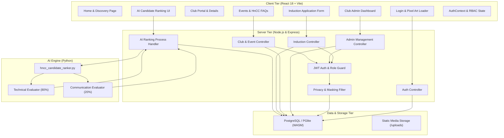
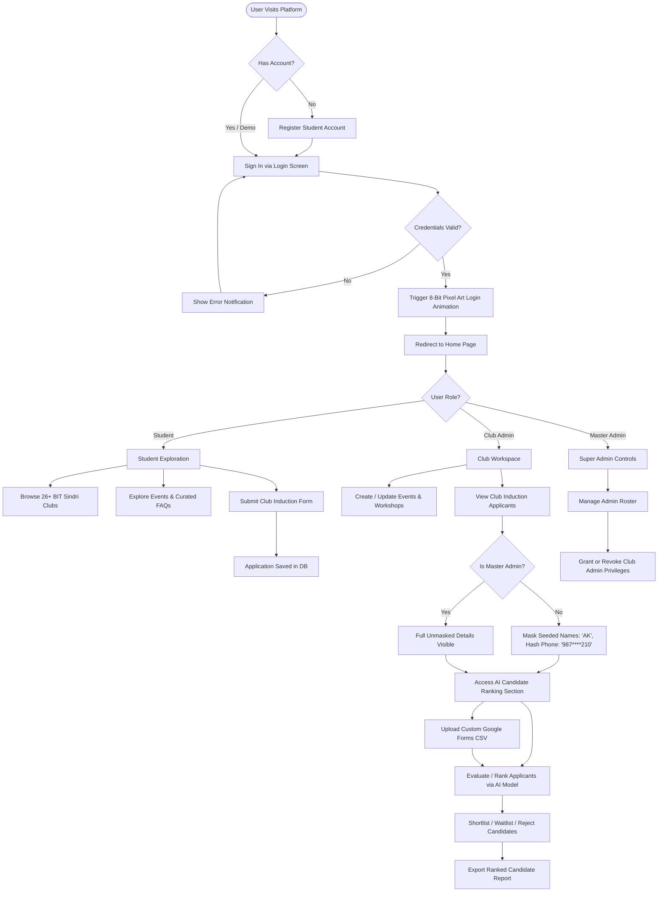
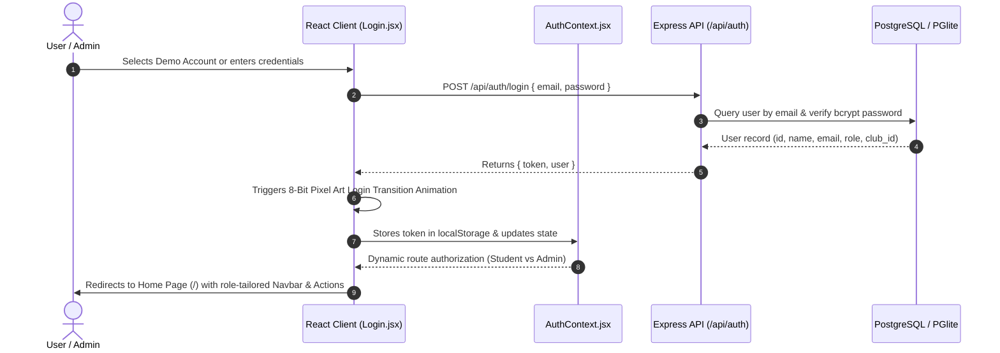
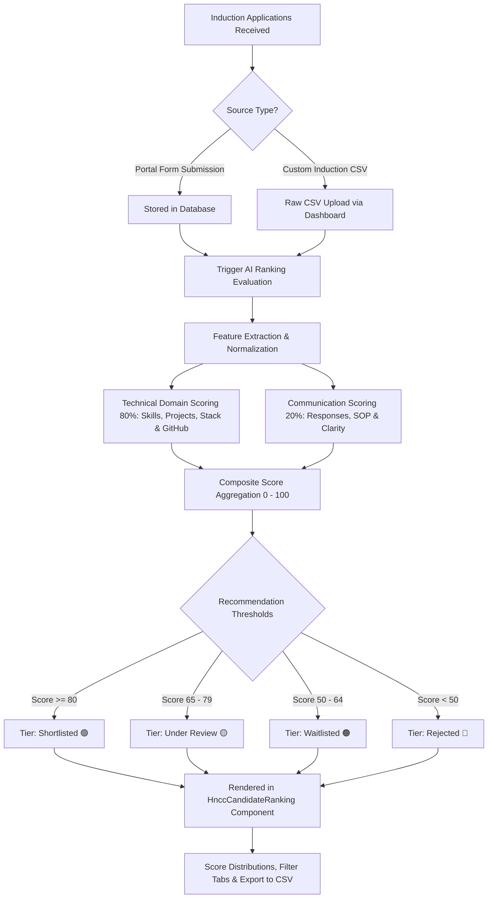
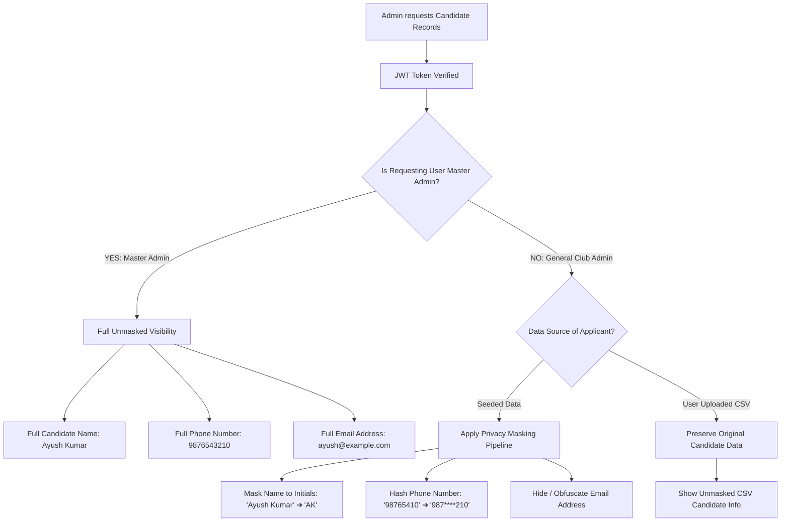
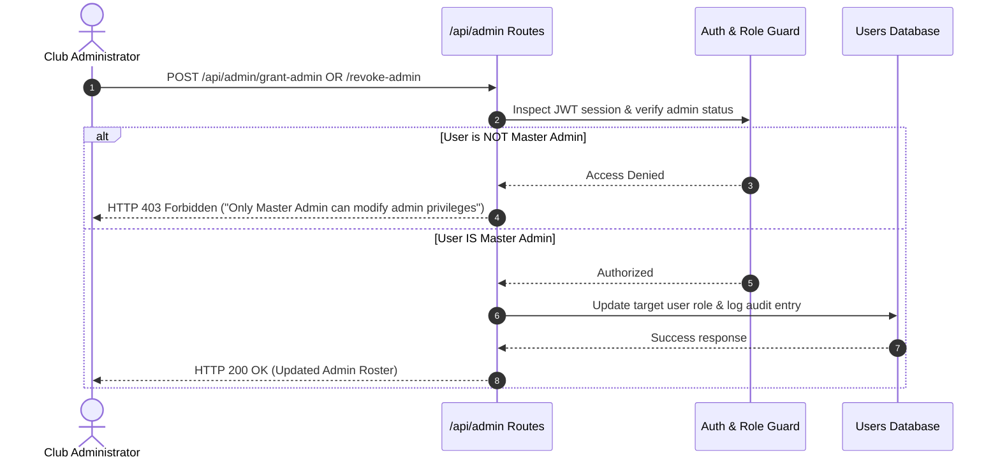

# BIT Sindri Clubs Dashboard & HnCC Induction Engine

A comprehensive full-stack platform designed to unify college club activities, induction workflows, AI candidate evaluation, event management, and secure role-based administration for **BIT Sindri**.

Built with a **Node.js Express** backend (with embedded PGlite / PostgreSQL), **Python AI Ranking Engine**, and a **React (Vite)** frontend.

---

## 🌟 Key Features & Recent Updates

### 🤖 1. AI-Powered Candidate Evaluation & Ranking (HnCC)
- **Multi-Factor Scoring Engine**: Automated evaluation pipeline evaluating candidates on:
  - Technical skills (80%)
  - Communication skills (20%)
- **Applicant Workspace Integration**: Positioned directly below the applicant directory in the Club Workspace for immediate decision-making.
- **Custom CSV Evaluation**: Upload custom applicant CSVs for live AI scoring, score distributions, and exportable ranking reports.
- **Status Management**: Filter and transition candidates across `Shortlisted`, `Under Review`, `Waitlisted`, and `Rejected`.

### 🛡️ 2. Privacy & Data Masking Guards
- **Candidate Anonymization for Club Admins**:
  - Seeded applicant names are automatically masked to initials (e.g. `Ayush Kumar` $\to$ `AK`, `Gaurav Roy` $\to$ `GR`).
  - Applicant phone numbers are hashed (e.g. `98765410` $\to$ `987****210`).
  - Full details remain accessible exclusively to the Master Administrator.
- **Dynamic Scope**: User-uploaded CSV candidate records retain original formatting and are not masked.
- **Admin Directory Privacy**: Restricted admin views mask fellow administrators' email addresses and phone numbers.

### 🔐 3. Granular Role-Based Access Control (RBAC)
- **Super / Master Admin Privilege**:
  - Only master admin has the authority to grant or revoke club administrator roles.
  - Non-master admins have administrative promotion/revocation controls disabled and hidden.
- **Applicant Restrictions**:
  - Club administrators are restricted from applying to any club inductions (enforced across backend routes and client UI).
- **Post-Login Routing**: Automatic redirection to the Home Page on login for intuitive navigation.

### 🎨 4. Modern UI, Pixel Art Animations & Interactive Experience
- **Pre-Configured Demo Accounts**: 3 quick-fill demo cards on the Login page:
  - **Rahul (HnCC Admin)**: Full administrative and induction privileges.
  - **Demo Student 1 & 2**: Student profile testing for induction applications and club exploration.
- **Pixelated Art Login Experience**: Retro 8-bit style visual branding and animated transitions upon successful sign-in.
- **Curated HnCC FAQs**: Interactive accordion FAQ section curated directly from official HnCC resources on the Events page.
- **Club Event Workspace**: View and manage upcoming college hackathons, coding contests, and workshops with custom banner art.

### ⚡ 5. Dual-Engine Database Architecture
- **Embedded PGlite Support**: Uses `@electric-sql/pglite` (WASM PostgreSQL in Node.js) for instantaneous, zero-configuration local development without installing an external database server.
- **Production PostgreSQL**: Seamless fallback to standard PostgreSQL connection pools via environment variables.

---

## 🏗️ Detailed Architecture & System Flow

### High-Level System Architecture Diagram

```
┌────────────────────────────────────────────────────────────────────────────────────────────────────────┐
│                                   BIT SINDRI UNIFIED CLUBS PLATFORM                                    │
└────────────────────────────────────────────────────────────────────────────────────────────────────────┘

  👥 USER ROLES & PERSONAS
  ┌───────────────────────────┐      ┌───────────────────────────┐      ┌───────────────────────────┐
  │         🎓 STUDENT        │      │       🛡️ CLUB ADMIN       │      │      👑 MASTER ADMIN      │
  │  (Apply, Explore, Events) │      │  (Manage Club & Inductions)│     │(Full Access, RBAC Control)│
  └─────────────┬─────────────┘      └─────────────┬─────────────┘      └─────────────┬─────────────┘
                │                                  │                                  │
                ▼                                  ▼                                  ▼
  💻 FRONTEND CLIENT TIER (React 18 + Vite)
  ┌───────────────────────────────────────────────────────────────────────────────────────────────────────┐
  │ • React Router v6 & Protected Routes                                                                  │
  │ • AuthContext (JWT Session Management & RBAC UI Guards)                                               │
  │ • Pages: Home, Clubs, ClubDetail, Events, ApplyInduction, AdminDashboard, Login                      │
  │ • Components: HnccCandidateRanking, ClubCard, Navbar, Footer, ImageUploader, PixelArtLoader         │
  │ • Themed UI: Glassmorphism, Retro Pixel-Art Animations, Micro-interactions                            │
  └──────────────────────────────────────────────────┬────────────────────────────────────────────────────┘
                                                     │ HTTP / REST API (Bearer JWT)
                                                     ▼
  ⚙️ BACKEND API & CONTROLLER TIER (Node.js & Express)
  ┌───────────────────────────────────────────────────────────────────────────────────────────────────────┐
  │ • Express Server & REST Router (CORS, JSON BodyParser, Multer File Uploads)                          │
  │ • Authentication & JWT Middleware (Token Verification & Role Extraction)                              │
  │ • Role-Based Access Control (RBAC) & Permission Guards                                                │
  │ • Privacy & Anonymization Engine (Initial Masking, Phone Hashing, Scope Filtering)                    │
  │                                                                                                       │
  │ ┌──────────────────┐  ┌──────────────────┐  ┌──────────────────┐  ┌──────────────────┐                │
  │ │  /api/auth       │  │  /api/admin      │  │  /api/clubs      │  │  /api/events     │                │
  │ └──────────────────┘  └──────────────────┘  └──────────────────┘  └──────────────────┘                │
  │ ┌──────────────────┐  ┌──────────────────┐  ┌──────────────────┐                                      │
  │ │  /api/induction  │  │  /api/upload     │  │  /api/health     │                                      │
  │ └──────────────────┘  └──────────────────┘  └──────────────────┘                                      │
  └───────────────────────────────┬──────────────────────────────────────┬────────────────────────────────┘
                                  │                                      │
                                  ▼                                      ▼
  🤖 AI / ML EVALUATION ENGINE                     🗄️ PERSISTENCE & DATA TIER
  ┌──────────────────────────────────────────┐    ┌───────────────────────────────────────────────────────┐
  │ • Python NLP Subprocess Pipeline         │    │ • Dual Database Engine:                               │
  │ • Script: hncc_candidate_ranker.py       │    │   - Embedded PGlite (WASM PostgreSQL in Node.js)      │
  │ • Scoring Formula:                       │    │   - Standalone PostgreSQL (Production Fallback)       │
  │   - 80% Technical Skills                 │    │ • Relational Tables:                                  │
  │   - 20% Communication Skills             │    │   - users, clubs, events, applications,               │
  │ • Track Weighting & Normalization        │    │     candidate_rankings, audit_logs                    │
  └──────────────────────────────────────────┘    └───────────────────────────────────────────────────────┘
```

### Component Architecture & Interactions



---

## 🔄 Full Platform Flow Diagrams

### 1. End-to-End User Journey & Life Cycle



---

### 2. Authentication & Dynamic Session Flow



---

### 3. AI Candidate Evaluation & Shortlisting Pipeline



---

### 4. Data Privacy, Masking & Role Security Flow



---

### 5. Admin Hierarchy & Privilege Guard Flow



---

## 📁 Project Structure

```
.
├── backend/                       # Node.js Express REST API & AI Service
│   ├── src/
│   │   ├── ai/                    # Python AI ranking script (hncc_candidate_ranker.py)
│   │   ├── db/                    # PGlite / PostgreSQL connection, schema & seeds
│   │   │   ├── init.js            # Table initialization
│   │   │   └── seed_admins.js     # Master & club admin seeding
│   │   ├── middleware/            # JWT authentication & role-based middleware
│   │   ├── routes/                # Auth, Admin, Clubs, Events, Induction, Upload
│   │   └── index.js               # Express application entrypoint
│   └── package.json
├── frontend/                      # React (Vite) Single Page Application
│   ├── src/
│   │   ├── assets/                # Logos, college crests, pixel art graphics
│   │   ├── components/            # HnccCandidateRanking, Navbar, Footer, ClubCard
│   │   ├── context/               # AuthContext session & state management
│   │   ├── pages/                 # Home, Clubs, Events, AdminDashboard, Login
│   │   ├── App.jsx                # Route declarations & layout structure
│   │   └── main.jsx               # React DOM entrypoint
│   └── package.json
├── api/                           # Serverless entrypoint for Vercel deployment
├── vercel.json                    # Monorepo deployment routing configuration
└── package.json                   # Root workspace scripts
```

---

## 🔑 Demo Credentials

| Role | Name | Email | Password | Permissions |
| :--- | :--- | :--- | :--- | :--- |
| **Master Admin** | Rahul (HnCC) | `hncc.admin@bitsindri.ac.in` | `admin123` | Full access, unmasked candidate data, admin grant/revoke |
| **Club Admin** | Club Admin | `admin@bitsindri.ac.in` | `admin123` | Club workspace, masked seeded candidates, no admin grant/revoke |
| **Student 1** | Aryan Raj | `student.demo@bitsindri.ac.in` | `student123` | Induction applications, event participation |
| **Student 2** | Priya Sharma | `student2.demo@bitsindri.ac.in` | `student123` | Induction applications, club exploration |

---

## 🚀 Quick Start Guide

### Prerequisites
- **Node.js** (v18 or higher)
- **npm** (v9 or higher)
- **Python 3.9+** (optional, for standalone AI ranking execution)

---

### Step 1: Install Dependencies
From the root directory:
```bash
npm run install:all
```
*(Or run `npm install` inside both `backend/` and `frontend/` directories).*

---

### Step 2: Configure Environment Variables
Inside `backend/`:
```bash
cp .env.example .env
```

Ensure `.env` contains:
```env
PORT=5000
JWT_SECRET=super_secret_jwt_key_hacktober
USE_PGLITE=true
```
> **Note**: `USE_PGLITE=true` runs the embedded database engine automatically. If using a standalone PostgreSQL database, set `USE_PGLITE=false` and provide `DB_HOST`, `DB_PORT`, `DB_USER`, `DB_PASSWORD`, and `DB_NAME`.

---

### Step 3: Initialize Database & Seed Admins
```bash
cd backend
npm run init-db
npm run seed-admins
```

---

### Step 4: Run Development Servers

**Option A — Concurrent Root Command:**
```bash
# In the project root
npm run dev
```

**Option B — Independent Terminals:**
```bash
# Terminal 1: Backend API (http://localhost:5000)
cd backend
npm run dev

# Terminal 2: Frontend Client (http://localhost:5173)
cd frontend
npm run dev
```

Open [http://localhost:5173](http://localhost:5173) in your browser.

---

## 📊 AI Candidate Evaluation Pipeline

The AI evaluation engine evaluates applicants through `backend/src/ai/hncc_candidate_ranker.py`:
1. **Technical Skills Scoring (80%)**: Evaluates competencies against relevant domains (Web Dev, App Dev, ML/AI, Cloud/DevOps, Competitive Programming), GitHub profiles, portfolio links, and branch/year alignment.
2. **Communication Skills Scoring (20%)**: Evaluates candidate responses, statements of purpose, and clarity.
3. **Recommendation Tiers**: Outputs individual sub-scores alongside recommendation tiers (`Shortlisted`, `Under Review`, `Waitlisted`, `Rejected`).

---

## 🛡️ Security & Privacy Guardrails

- **JWT Role Middleware**: Protected routes verify signed JWT tokens on every privileged request.
- **Seeded Data Anonymization**: Automatic string regex masking hides full names and phone numbers from non-master admins while preserving search and filtering integrity.
- **Admin Isolation**: Club administrators cannot self-promote, modify other admin accounts, or submit induction applications as students.

---

## 📜 Contributing & License

Contributions are welcome via Pull Requests. Please ensure all merges with `main` maintain 0 conflicts and pass build checks:
```bash
npm --prefix frontend run build
```

Licensed under the **ISC License**.
